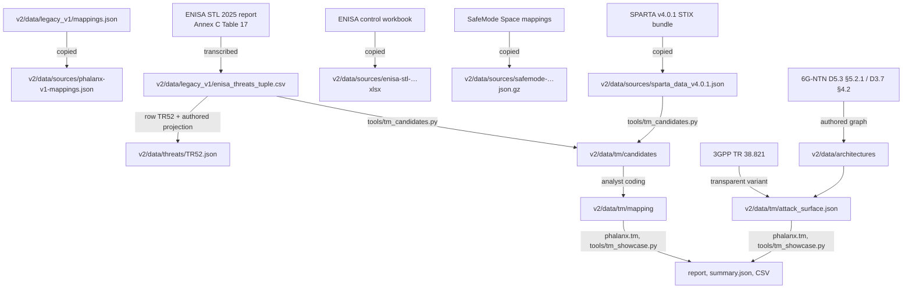

# Provenance

What every file in this repository is, where it comes from, and how it is produced. Update this file in the
same commit whenever a file is added, regenerated from a new source, or changes status.

**Kinds**

| Kind | Meaning |
|---|---|
| copied | byte copy of an external file; sha256 pinned in `v2/data/sources/manifest.json` |
| transcribed | copied by hand from a document (e.g. a PDF table) |
| derived | computed from other files by a script or a stated rule |
| authored | written by an analyst; a judgement, not a computation |
| generated | written by the engine; never edited by hand |

**Status:** `draft` = may still change; `frozen` = hash committed, changes need a recorded deviation; `proposed` = analyst-drafted, not yet reviewed.

---

## How the materials derive from each other

---

## Repository root

| Path | Kind | What it is |
|---|---|---|
| `README.md` | authored | project description |
| `CLAUDE.md`, `.claude/settings.json`, `docs/agents/` | authored | instructions for coding assistants (method summary, commands, guardrails, issue conventions) |
| `PROVENANCE.md` | authored | this file |
| `assets/*.png` | authored | logo, emblem, mark |

## `v2/`

| Path | Kind | What it is |
|---|---|---|
| `v2/README.md` | authored | setup, CLI, data model, boundary naming |
| `v2/THIRD_PARTY_NOTICES.md` | authored | third-party sources, licences, attributions and modifications |
| `v2/pyproject.toml`, `v2/.gitignore` | authored | package `phalanx`, CLI entry `phalanx`; ignores `.venv/`, `out/`, caches |

### `v2/src/phalanx/` — code

| File | What it does |
|---|---|
| `tm.py` | scenario engine: access routes computed from architecture links; scenarios per threat × architecture × origin × route × credential × security configuration; entry, authority, reachability, door, crosslink, link-only and ground-side rules; architecture comparison |
| `cli.py` | commands `sources`, `validate`, `list`, `run`, `explain`, `outcomes`, `compare`, `metrics`, `anchors`, `b1`, `linkage` |
| `workspace.py` | loads `v2/data`, validates schemas and cross-references, checks SPARTA ids (I10) |
| `sources.py` | pinned-source manifest; SPARTA catalog loader; ENISA workbook and SafeMode crosswalk (generator MAP-CG-01) |
| `engine.py` | nine-check decision engine, modes B3 (full) and B2 (scenario-only): candidate generators → nine checks → decision record → attack flow → boundary verdicts → controls → findings. Pure functions, no IO |
| `pipeline.py` | builds engine inputs from the workspace, canonical hash, invariant check, `outcomes` summary |
| `baselines.py` | B0 = v1 engine over `data/legacy_v1/` (mapping hash checked against the pinned copy); B1 and B1b crosswalk baselines |
| `evaluation.py` | EvaluationCell normalization, applicability predicates, per-scenario counts and paired contrasts |
| `anchors.py` | re-resolves published anchor IDs against the catalog; flags malformed / not_found / deprecated / label_mismatch; suggests, never applies, corrections |
| `metrics.py` | anchor recovery, constructed negatives, directional pass, record completeness, replay, unresolved / no-coverage |
| `registry.py` | loads and checks the rule registry |
| `selectors.py` | resolves ENISA asset selectors per scenario and architecture into four states with evidence |
| `invariants.py` | output invariants I1, I2, I4, I5, I6, I9, I11, I12 |
| `report.py` | markdown run report and nine-check `explain` trace |
| `schemas/*.schema.json` | JSON Schema for threat and projection, architecture, scenario, technique rules, evidence clauses, decision record, attack flow, evaluation cell |

### `v2/data/` — inputs

| Path | Kind | What it is | Derived from | Status |
|---|---|---|---|---|
| `sources/manifest.json` | authored | path, version, sha256, licence per pinned input | `sha256sum` | — |
| `sources/sparta_data_v4.0.1.json` | copied | SPARTA v4.0.1 STIX bundle | sparta.aerospace.org STIX download; SPARTA terms of service | pinned |
| `sources/safemode-mappings-v2026.09.23-1.json.gz` | copied | SafeMode Space mapping release 2026.09.23-1; `enisa_control` edges feed MAP-CG-01 | doi 10.5281/zenodo.22911569 (CC BY 4.0) | pinned |
| `sources/enisa-stl-control-framework-2025-03.xlsx` | copied | ENISA STL 2025 Control Framework workbook | github.com/enisaeu/Space-Threat-Landscape, git blob ac602576 (CC BY 4.0) | pinned |
| `sources/fight-v3.1.0.yaml` | copied | MITRE FiGHT v3.1.0 | github.com/mitre/FiGHT commit 097cd5f7, `fight.yaml` (Apache-2.0) | pinned |
| `sources/phalanx-v1-mappings.json` | copied | `legacy_v1/mappings.json`; feeds generator MAP-CG-03 (regression only) | `legacy_v1/mappings.json` | pinned |
| `sources/licenses/` | copied | licence texts: SPARTA terms of service, CC BY 4.0, Apache-2.0, FiGHT repository licence | publishers' sites; FiGHT repository | — |
| `legacy_v1/ntn_threat_algorithm.py` | authored | v1 engine (Pass 1 derives segments, trust boundaries and lifecycle from assets; Pass 2 classifies with rules R1–R10); emits no SPARTA techniques | — | frozen |
| `legacy_v1/enisa_threats_tuple.csv` | transcribed + derived | 58 ENISA threats as 10-element tuples; CIA and affected assets transcribed from Annex C Table 17 (pp. 85–95) | ENISA STL 2025 report | frozen |
| `legacy_v1/mappings.json` | authored | the only SPARTA techniques v1 produces (TR52, SPARTA v3.2 IDs); B0 = v1 engine + this file | — | frozen |
| `tm/attack_surface.json` | authored | nodes, links, controls, attacker origins, entry/door/crosslink techniques, trust-boundary labels for transparent, G-CONV and G-D53 | `architectures/`; 3GPP TR 38.821 (transparent); additions marked `assumed` | draft |
| `tm/adversary.json` | authored | adversary role per threat from ENISA category and quoted overrides | ENISA STL 2025 Annex C | draft |
| `tm/enisa_index.json`, `tm/sparta_live.json` | derived | ENISA threat index; non-deprecated SPARTA techniques | ENISA STL 2025 Annex C; SPARTA v4.0.1 | — |
| `tm/candidates/<TR>.json` | generated | SPARTA candidates per adversarial threat | `tools/tm_candidates.py` | — |
| `tm/mapping/<TR>.json` | authored | access vectors and one reason code per candidate, with ENISA and SPARTA quotes | analyst-drafted (AI-assisted); author field per file | proposed |
| `architectures/G-D53.json`, `G-CONV.json` | authored | split-RAN and conventional variants with TT&C chain; each edge has `role`, `transition`, `figure_alias` with stated/interpretation basis | 6G-NTN D5.3 §5.2.1, D3.7 §4.2; TT&C edges author-defined | draft |
| `threats/TR52.json` | transcribed + authored | TR52 "Seizure of control" with projection | `legacy_v1/enisa_threats_tuple.csv` row TR52 | draft |
| `threats/TR01…TR58.json` (except held-out threats) | generated + authored | name, description, CIA, selectors, lifecycle from the Annex C row (validated against it); SV-* claims authored without SPARTA's technique links; unreviewed | `legacy_v1/enisa_threats_tuple.csv`; SPARTA v4.0.1 SV-* | draft |
| `scenarios/<ET>/*.json` | authored | scenario instances for TR52 (A, A_CONV, B, B′, C, C′) and development scenarios for TR15, TR28, TR40, TR54, TR55 | — | draft |
| `rules/vocabulary.json`, `rules/techniques.json`, `rules/evidence/TR52.json` | authored | reason codes, boundary roles, generators, authority rules; technique profiles and seeds; TR52 evidence clauses | SPARTA v4.0.1 technique text; ENISA Annex C | draft |
| `anchors/published_mappings.json` | transcribed | published anchor assertions as printed (OPS-SAT, Frøseth, SpyChain, Ear; Viasat descriptive) | the published sources, identifiers only | draft |
| `anchors/opssat_emb3d.json` | transcribed | B1 input: EMB3D TIDs and SPARTA IDs per OPS-SAT step | spacesecurity.info OPS-SAT analysis | draft |
| `anchors/et_linkage.json` | authored | anchor → ENISA threat linkage with verbatim quotes, rationale, confidence | anchor sources; `legacy_v1/enisa_threats_tuple.csv` | frozen (main links) |
| `anchors/adjudications.json` | authored | proposed corrections for flagged anchor IDs; never applied by the resolver | — | proposed |
| `expectations/TR52.json` | authored | expectations over TR52 scenario pairs | — | draft |
| `selectors/enisa_asset_selectors.json` | authored | scope of every Annex C selector clause; asset classes of architecture assets | `legacy_v1/enisa_threats_tuple.csv` | draft |

### `v2/tests/`

| Path | Kind | What it is |
|---|---|---|
| `test_*.py`, `conftest.py` | authored | engine, scenario engine, comparison, anchors, invariants, metrics, registry, schemas, selectors |
| `fixtures/anchor_resolution.json` | derived | stored anchor re-resolution (`phalanx anchors -o`) |
| `fixtures/tr52_pilot_outcomes.json` | derived | every decision of the TR52 pilot; regenerate with `phalanx outcomes` only for a recorded rule change |

### `v2/docs/`, `v2/tools/`

| Path | What |
|---|---|
| `docs/rule_registry.json`, `docs/rule_namespace_crosswalk.md` | legacy v1 rules and current rules with namespaced ids, versions and crosswalk |
| `tools/tm_candidates.py` | writes the SPARTA candidate list per adversarial threat and the live-technique extract |
| `tools/tm_validate.py` | checks mapping files against the coding contract (codes, quotes, entry techniques, cross-threat reciprocity) |
| `tools/tm_showcase.py` | builds the report: kill chains per threat × architecture × origin × security configuration, architecture comparison |

### Not in git

| Path | What | Produced by |
|---|---|---|
| `v2/out/` | run bundles, reports, comparisons | `phalanx run`, `compare`, `metrics`, `tools/tm_showcase.py` |
| `v2/.venv/` | Python environment | `python3 -m venv .venv && .venv/bin/pip install -e '.[test]'` |
