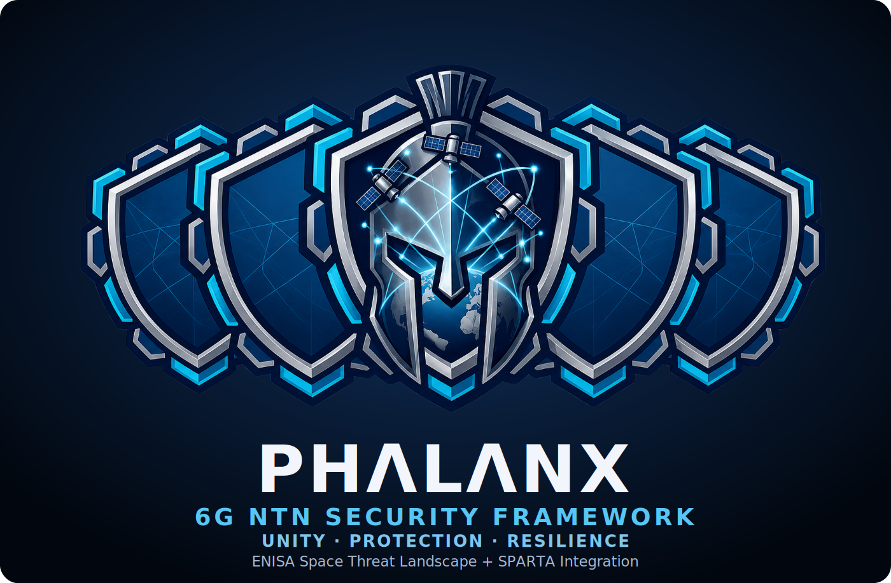

<p align="center">
  
</p>

<p align="center"><em>Architecture-first threat modeling for 6G non-terrestrial networks: ENISA threats as SPARTA kill chains.</em></p>

---

## The name

A **phalanx** was a line of soldiers whose shields locked edge to edge; its strength lay in the seams
between them. PHALANX applies the idea to space-threat knowledge. The **ENISA Space Threat Landscape**
describes _what_ can go wrong and _where_ (segments, assets, trust boundaries, lifecycle); **SPARTA**
describes _how_ an adversary does it (techniques, tactics, countermeasures). PHALANX joins the two, threat
by threat, on concrete 6G NTN architectures.

## What it does

PHALANX takes an ENISA Space Threat Landscape 2025 threat, places it on a 6G NTN architecture and an
attacker scenario, and derives the SPARTA v4.0.1 kill chain that the scenario allows. Every kept or removed
step carries a reason code and a source quote, so each result can be traced back to the ENISA text, the
SPARTA technique description and the architecture model.

Three architecture variants are modelled:

| Variant | RAN placement | Basis |
|---|---|---|
| `transparent` | gNB on the ground; the satellite relays Uu | 3GPP TR 38.821 |
| `G-CONV` | whole gNB on one satellite | 6G-NTN D3.7 §4.2 |
| `G-D53` | DU and CU on two satellites, F1 over the inter-satellite link | 6G-NTN D5.3 §5.2.1 |

A scenario combines threat × architecture × attacker origin × access route × credential × security
configuration (SDLS, NDS/IP, F1 IPsec, 5G AS/NAS, hosted-RAN segregation). The engine computes access
routes from the architecture's links and reports, per scenario, which steps remain and why the others are
removed, together with the trust boundaries the route crosses.

## Status

Development stage. The 34 threat mappings in `v2/data/tm/mapping/` are analyst-drafted and carry
`status: proposed`; they have not yet been reviewed. Results are modelled applicability on the stated
architecture assumptions, not measurements of deployed systems.

## Quickstart

```bash
cd v2
python3 -m venv .venv && .venv/bin/pip install -e '.[test]'   # Python ≥ 3.11
.venv/bin/pytest -q                                             # test suite
.venv/bin/python tools/tm_validate.py                           # check the mapping files
.venv/bin/python tools/tm_showcase.py out/showcase              # HTML report, summary.json, per-threat CSV
```

See [`v2/README.md`](v2/README.md) for the engine, data model and all commands.

## Repository layout

```
v2/
  src/phalanx/     engine (tm.py: scenario engine; engine.py: nine-check decision engine)
  data/tm/         attack surface, adversary roles, candidates and reason-coded mappings
  data/sources/    pinned third-party inputs (SPARTA, ENISA, SafeMode, FiGHT) and licence texts
  data/legacy_v1/  v1 prototype engine and data, used as comparison baseline B0
  tests/  tools/  docs/
assets/            logo
PROVENANCE.md      origin of every file
```

## Data and attribution

PHALANX redistributes or derives from third-party data: SPARTA (© The Aerospace Corporation), the ENISA
Space Threat Landscape 2025 and its Control Framework (CC BY 4.0), SafeMode Space mappings (CC BY 4.0) and
MITRE FiGHT (Apache-2.0). Terms, attributions and modifications are listed in
[`v2/THIRD_PARTY_NOTICES.md`](v2/THIRD_PARTY_NOTICES.md); licence texts are in `v2/data/sources/licenses/`.
